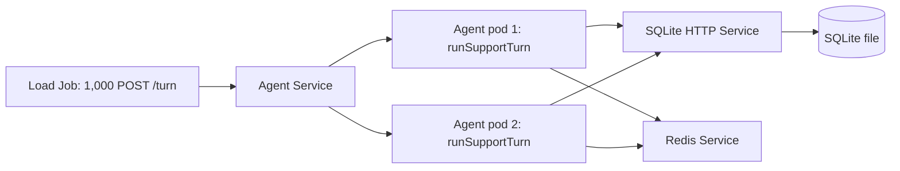

# Local Kubernetes agent load design

## Problem

The live chat stores sessions and messages in Supabase and calls an external model. A local traffic experiment must exercise the repository's `runSupportTurn` logic without sending 1,000 paid model requests or changing production data. The experiment needs one SQLite server for durable state during a run, Redis for a disposable cache, multiple agent workers, and a load client that checks answers as well as latency. It is a controlled simulation of the order lookup path, not a production capacity estimate.

## Usage from the caller's view

Run `bash scripts/local-load/run-kind.sh` while Docker and a kind cluster are available. The command checks the selected kind context, builds local images, creates only the `next-agent-load` namespace, starts SQLite, Redis, and two agent replicas, then sends 1,000 HTTP `POST /turn` requests at 64 concurrent clients. It prints one JSON report and exits nonzero if a request fails, an answer is wrong, or SQLite does not contain 1,000 complete message pairs.

The caller can set `KIND_CLUSTER` for another kind cluster. `LOAD_TURNS` and `LOAD_CONCURRENCY` in the Job manifest set the request count and client limit. The default run uses 1,000 and 64. A repeated run restarts the disposable SQLite and Redis pods, clears their prior state, and creates a new Job. To remove this disposable environment, run `kubectl delete namespace next-agent-load`.

The agent service exposes one test endpoint. `POST /turn` accepts `{ "requestId": "<uuid>" }` and returns the session ID, turn ID, checked reply, and cache outcome. A sequential retry with the same request ID preserves the stored pair. Concurrent duplicate calls to the same session are outside this one-turn workload. The load client checks the response and the SQLite count after all requests finish.

## Current path and boundaries

`runSupportTurn` owns the LangGraph turn. Its order dependency reads a catalog and updates the unmatched order streak. The live app wires those dependencies to Supabase in `src/infra/live-runtime.ts`. The simulator wires the same turn function to a scripted model, a fixed order fixture, SQLite state, and Redis cache. It does not call the Next.js chat route, Supabase, OpenRouter, or the other three support tools. Those paths need separate load tests before production sizing.

The load Job sends HTTP requests to the agent Service. Kubernetes spreads them over two stateless agent pods. Both pods use the same SQLite HTTP Service and Redis Service. SQLite has one pod and one database file. Redis has one pod and no persistence. The cache never owns a session, message, streak, or other business outcome.



## Shape

The request identity is a UUID. This single value is the session ID and turn ID in the one-turn scenario. It makes retries address the same rows. The stored pair has a customer row and an assistant row with a unique key on `(session_id, turn_id, role)`. The SQLite server writes the pair in one transaction and checks the existing pair on a duplicate request. A duplicate with different content is a conflict.

```ts
type TurnRequest = { readonly requestId: string };
type CacheOutcome = "hit" | "miss" | "unavailable";
type TurnReply = {
  readonly sessionId: string;
  readonly turnId: string;
  readonly reply: string;
  readonly cacheOutcome: CacheOutcome;
};
type LoadReport = {
  readonly requested: number;
  readonly concurrency: number;
  readonly successes: number;
  readonly errors: number;
  readonly p50Ms: number | null;
  readonly p95Ms: number | null;
  readonly durationMs: number;
  readonly turnsPerSecond: number;
  readonly sqlite: {
    readonly sessions: number;
    readonly customers: number;
    readonly assistants: number;
    readonly wrong_replies: number;
  };
};
```

The module boundaries follow the state owners.

| Module | Public operation | State and invariant it owns |
| --- | --- | --- |
| `agent-server.ts` | `POST /turn` | Parses the request once and maps turn failures to HTTP responses. |
| `agent-turn.ts` | `runSimulatedTurn(requestId)` | Calls the real `runSupportTurn` with one scripted order lookup. |
| `sqlite-server.mjs` | `POST /sessions`, `PUT /streak`, `POST /messages`, `GET /stats` | Owns SQLite schema, bounded input, transactions, and duplicate detection. |
| `redis-client.ts` | `redisCommand` | Encodes one Redis command and parses its response. |
| `load.ts` | 1,000 bounded HTTP calls | Checks replies, counts failures, and compares SQLite rows with requests. |
| `run-kind.sh` | One isolated run | Checks cluster context, builds images, applies manifests, waits, and reads Job logs. |

The SQLite server is one process using Node's `DatabaseSync`. The HTTP boundary serializes short synchronous SQL operations in that process. The agent pods never mount or write the database file. This avoids several pods writing the same SQLite file through a shared Kubernetes volume. The server uses WAL mode and a unique message key. WAL improves concurrent reads but still permits only one writer at a time. The test should expose that limit instead of hiding it behind separate per-pod files. See [SQLite's WAL concurrency rules](https://www.sqlite.org/wal.html).

The order fixture is immutable for the whole run. On a cache hit, the agent checks that Redis contains the expected fixture. On a miss, it uses the fixed fixture and sets a ten-minute TTL. If Redis is unavailable, the agent uses the same fixture and reports `unavailable`. The order answer must stay correct in all three cases. There is no cache invalidation protocol because the fixture cannot change during this experiment. A changing catalog would need a versioned key or an invalidation owner.

The request path is `load.ts` to `agent-server.ts` to `runSupportTurn` to the SQLite and Redis adapters, then back to the load client. The client validates the literal expected order answer and tool name. At the end it reads SQLite counts. Every request must create one session, one customer row, and one assistant row. A non-2xx response, wrong answer, mismatched row count, or Redis failure that changes the answer makes the Job fail.

## Synthesis decision

Two structurally different shapes were considered. The chosen shape is a stateless HTTP agent Service with two replicas, one SQLite HTTP owner, and a disposable Redis cache. It keeps the caller's interface at one `POST /turn` request while exercising the repository's turn logic and the shared storage boundary. It also lets the load client measure the network path and Kubernetes load balancing.

An initial single Job called `runSupportTurn` directly for each turn and used SQLite and Redis services. That shape proved the dependency wiring but did not send HTTP requests to an agent pod or exercise more than one app replica. The Service design keeps its direct use of `runSupportTurn` and its answer checks, then adds the request boundary. A full local replacement for Supabase and the external model would exercise more of the app, but it would require implementing the entire catalog and session contract in a second database adapter. That would make the experiment's differences from production harder to interpret.

Parallel architect candidates could not complete because the agent service reported a usage limit. This synthesis is a sequential comparison, so an independent design verdict remains open.

## Tradeoffs accepted

- We use a scripted model so 1,000 requests are reproducible and do not incur external model cost. The result excludes model latency and provider throttling.
- We use one SQLite writer so the run can measure contention at that boundary. This is not a design for scaling SQLite writes across many pods.
- We use an `emptyDir` database volume so local runs leave no tracked data. Restarting the SQLite pod loses the run. Redis persistence is disabled.
- We run a fixed order lookup and one turn per session. The test does not cover multi-turn ordering, other tools, or simultaneous writes to the same session.

## Alternatives considered

| Shape | Capability hidden | Complexity exposed to callers | Decision |
| --- | --- | --- | --- |
| Two agent replicas plus SQLite and Redis Services | Routing, SQL transaction, cache fallback, and answer checks | One run command and one HTTP request | Chosen. |
| One load Job calling `runSupportTurn` directly | SQL and cache access | No HTTP agent endpoint; no app replica behavior | Rejected for the requested 1,000-request simulation. |
| Full Next.js app with local replacements for every Supabase port | Most production flow | Catalog migration, credentials, and divergent persistence contracts | Deferred to a separate integration effort. |
| SQLite file on a shared volume mounted by every agent pod | Almost none | Filesystem locks, WAL placement, and corruption risk across pods | Rejected. |

## Failure behavior and limits

The SQLite server validates UUIDs, text fields, and body size at the HTTP boundary. It commits a customer and assistant pair together or writes neither. A retry with the same request ID must be idempotent. An SQL failure returns a service error and increments the load client's error count. Redis failures become cache misses with an `unavailable` outcome and do not change the order result. The load client bounds concurrency, times each complete HTTP request, and verifies that timed requests reached the agent and wrote rows.

The JSON report gives p50, p95, maximum latency, total duration, throughput, request errors, cache outcomes, and SQLite row counts. These are observations from this local scripted workload. They cannot establish production throughput. Before claiming a speedup or choosing a capacity limit, run repeated trials with a known limiter, inspect CPU and memory of the load client and SQLite pod, and compare the same workload under controlled settings.

The namespace is `next-agent-load`. The script checks that the current context is the selected kind cluster before any apply. The Job has a 290-second deadline; a failed wait removes it after printing logs. It changes only resources in that namespace. The SQLite database file, Redis data, test logs, and any local secrets are ignored by Git. The Kubernetes manifests and test code are tracked so another engineer can repeat the run.

## Open questions and risks

- How does the path behave when the SQLite pod restarts mid-run? The `emptyDir` design predicts data loss and a failed count check; this needs a fault injection run.
- How much of the p95 time is SQLite serialization versus LangGraph work or the load client? Pod metrics and a second controlled run are needed before attribution.
- Does Redis outage preserve all replies under this load? A targeted outage test must check both the replies and the `unavailable` count.
- Should a later test cover two turns in one session and the other support tools? That needs a separate fixture contract.

## Verification

The SQLite HTTP contract has tests for the atomic pair, idempotent retry, conflicting retry, and invalid input. The repository suite, typecheck, lint, and the 1,000-request Kubernetes run must pass before this design is accepted. The run report records observed values; it is not a throughput guarantee.

## Observed local verification, 2026-10-24

The `kind-rolling-lab` run used 1,000 unique HTTP requests, 64 concurrent load workers, two agent replicas, one SQLite pod, and one Redis pod. All 1,000 replies matched the expected order answer. Redis recorded 998 hits, two misses, and zero unavailable results. SQLite held 1,000 sessions, 1,000 customer messages, and 1,000 assistant messages, with zero wrong replies. The load client measured p50 196.3 ms, p95 428.8 ms, maximum 693.8 ms, 3.56 seconds total, and 280.8 completed turns per second. This is one local run with a scripted model, so the figures describe only this fixture and machine.

A separate one-turn fault check scaled the Redis Deployment to zero in `next-agent-load`. The agent still returned HTTP 200 with the expected reply and `cacheOutcome: "unavailable"`. Redis was restored to one replica afterward. Repository verification also passed: 185 Vitest tests, TypeScript typecheck, ESLint, and the SQLite HTTP contract tests. The first two runs exposed a real environment collision: Kubernetes injected `REDIS_PORT` as a service URL. The client now reads `CACHE_REDIS_PORT` instead. A Docker registry connection reset during the first image build led to local esbuild bundling before Docker image creation; generated bundles remain ignored by Git.
