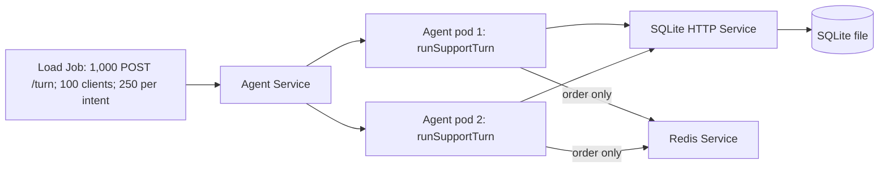

# Local Kubernetes agent load design

## Problem

The live chat stores sessions and messages in Supabase and calls an external model. A local traffic experiment must exercise the repository's `runSupportTurn` logic without sending 1,000 paid model requests or changing production data. The experiment needs one SQLite server for durable state during a run, Redis for a disposable cache, multiple agent workers, and a load client that checks answers as well as latency. It is a controlled simulation of four support tool paths, not a production capacity estimate.

## Usage from the caller's view

Run `bash scripts/local-load/run-kind.sh` while Docker and a kind cluster are available. The command checks the selected kind context, builds local images, creates only the `next-agent-load` namespace, starts SQLite, Redis, and two agent replicas, then sends 1,000 HTTP `POST /turn` requests at 100 concurrent clients. It prints one JSON report and exits nonzero if a request fails, an answer is wrong, the four intents are not equally represented, or SQLite does not contain 1,000 correct message pairs.

The caller can set `KIND_CLUSTER` for another kind cluster. `LOAD_TURNS` and `LOAD_CONCURRENCY` in the Job manifest set the request count and client limit. The default run uses 1,000 and 100. `LOAD_TURNS` must be divisible by four. A repeated run restarts the disposable SQLite and Redis pods, clears their prior state, and creates a new Job. To remove this disposable environment, run `kubectl delete namespace next-agent-load`.

The agent service exposes one test endpoint. `POST /turn` accepts `{ "requestId": "<uuid>", "intent": "order_status" }`, where intent is one of four named scenarios. It returns the session ID, turn ID, intent, tool, result kind, checked reply, cache outcome, trace ID, and estimated tokens. A sequential retry with the same request ID preserves the stored message pair. Concurrent duplicate calls to the same session are outside this one-turn workload. The load client checks the response and reads back each SQLite message pair after all timed requests finish.

## Current path and boundaries

`runSupportTurn` owns the LangGraph turn. The live app wires its dependencies to Supabase in `src/infra/live-runtime.ts`. The simulator wires the same turn function to a scripted model, four deterministic scenarios, SQLite session/message state, and a Redis order cache. Each scenario calls its real support tool: `lookup_order`, `search_products`, `claim_early_risers`, or `capture_handoff`. It does not call the Next.js chat route, Supabase, OpenRouter, or a real model provider. The scripted model selects a tool from the supplied intent; this does not measure natural-language intent classification.

The load Job assigns scenarios in interleaved order (`request index % 4`) and sends HTTP requests to the agent Service. Over 1,000 requests that yields exactly 250 per intent; it does not guarantee 25 active requests per intent at every instant. Kubernetes distributes requests over two agent pods. Both pods use the same SQLite HTTP Service. Order requests also use the Redis Service. SQLite has one pod and one database file. Redis has one pod and no persistence. The cache never owns a session, message, streak, or other business outcome.



## Shape

The request identity is a UUID. This single value is the session ID and turn ID in the one-turn scenario. It makes retries address the same rows. The stored pair has a customer row and an assistant row with a unique key on `(session_id, turn_id, role)`. The SQLite server writes the pair in one transaction and checks the existing pair on a duplicate request. A duplicate with different content is a conflict.

```ts
type TurnRequest = { readonly requestId: string; readonly intent: Intent };
type Intent = "order_status" | "product_search" | "promotion_claim" | "human_handoff";
type CacheOutcome = "hit" | "miss" | "unavailable" | "not_used";
type TurnReply = {
  readonly intent: Intent;
  readonly tool: string;
  readonly resultKind: string;
  readonly sessionId: string;
  readonly turnId: string;
  readonly reply: string;
  readonly cacheOutcome: CacheOutcome;
  readonly traceId: string;
  readonly estimatedTokens: { readonly input: number; readonly output: number };
};
type LoadReport = {
  readonly requested: number;
  readonly concurrency: number;
  readonly successes: number;
  readonly errors: number;
  readonly intents: Record<Intent, { readonly attempts: number; readonly successes: number; readonly errors: number; readonly p50Ms: number | null; readonly p95Ms: number | null }>;
  readonly p50Ms: number | null;
  readonly p95Ms: number | null;
  readonly durationMs: number;
  readonly turnsPerSecond: number;
  readonly sqlite: {
    readonly sessions: number;
    readonly customers: number;
    readonly assistants: number;
    readonly checked_pairs: number;
    readonly wrong_replies: number;
  };
};
```

The module boundaries follow the state owners.

| Module | Public operation | State and invariant it owns |
| --- | --- | --- |
| `agent-server.ts` | `POST /turn` | Parses the request once and maps turn failures to HTTP responses. |
| `agent-turn.ts` | `runSimulatedTurn(requestId, intent, trace)` | Calls the real `runSupportTurn` and checks the selected tool's structured result. |
| `scenarios.ts` | `scenarioForIndex`, `scenarioForIntent`, `validateScenarioResult` | Owns four fixed prompts, expected replies, tool arguments, and payload checks. |
| `sqlite-server.mjs` | `POST /sessions`, `PUT /streak`, `POST /messages`, `POST /messages/readback`, `GET /stats` | Owns SQLite schema, bounded input, transactions, duplicate detection, and pair readback. |
| `redis-client.ts` | `redisCommand` | Encodes one Redis command and parses its response. |
| `load.ts` | 1,000 bounded HTTP calls | Checks replies and intent balance, counts failures, and compares each SQLite pair with its request. |
| `run-kind.sh` | One isolated run | Checks cluster context, builds images, applies manifests, waits, and retains logs and resource snapshots. |

The SQLite server is one process using Node's `DatabaseSync`. The HTTP boundary serializes short synchronous SQL operations in that process. The agent pods never mount or write the database file. This avoids several pods writing the same SQLite file through a shared Kubernetes volume. The server uses WAL mode and a unique message key. WAL improves concurrent reads but still permits only one writer at a time. The test should expose that limit instead of hiding it behind separate per-pod files. See [SQLite's WAL concurrency rules](https://www.sqlite.org/wal.html).

The order fixture is immutable for the whole run. On a cache hit, the agent checks that Redis contains the expected fixture. On a miss, it uses the fixed fixture and sets a ten-minute TTL. If Redis is unavailable, the agent uses the same fixture and reports `unavailable`. The order answer must stay correct in all three cases. There is no cache invalidation protocol because the fixture cannot change during this experiment. A changing catalog would need a versioned key or an invalidation owner. The other three scenarios record `not_used` for the cache.

Product search uses a fixed catalog and deterministic embedding. Promotion claim uses a fixed eligible clock and a synthetic code; handoff records a pending proposal. The promotion and handoff stores are request-local fixtures, so the experiment checks the graph and immediate tool output without proving durable claim or proposal state across pods or retries. Four prompts are repeated 250 times each. Request IDs and sessions are unique; customer wording is not unique.

The request path is `load.ts` to `agent-server.ts` to `runSupportTurn` to the relevant tool adapters, then back to the load client. The agent validates the tool payload, result kind, and literal expected reply. The client validates the returned intent, tool, result kind, reply, IDs, cache use, and token estimate. At the end it reads SQLite counts and each stored customer/assistant pair by request ID. Every request must create one session, one customer row, and one assistant row. A non-2xx response, wrong answer, wrong pair, mismatched row count, intent imbalance, or Redis failure that changes the order answer makes the Job fail.

## Synthesis decision

Two structurally different shapes were considered. The chosen shape is a stateless HTTP agent Service with two replicas, one SQLite HTTP owner, and a disposable Redis cache. It keeps the caller's interface at one `POST /turn` request while exercising the repository's turn logic and the shared storage boundary. It also lets the load client measure the network path and Kubernetes load balancing.

An initial single Job called `runSupportTurn` directly for each turn and used SQLite and Redis services. That shape proved the dependency wiring but did not send HTTP requests to an agent pod or exercise more than one app replica. The Service design keeps its direct use of `runSupportTurn` and its answer checks, then adds the request boundary. A full local replacement for Supabase and the external model would exercise more of the app, but it would require implementing the entire catalog and session contract in a second database adapter. That would make the experiment's differences from production harder to interpret.

The mixed-intent extension keeps this service and storage shape. It adds a typed scenario registry shared by the client and agent, rather than four separate Jobs or a mutable cluster-wide fixture. The four intents have different state needs, so only the order path uses Redis, while claim and handoff use request-local fixtures with their durability limit stated explicitly.

## Tradeoffs accepted

- We use a scripted model so 1,000 requests are reproducible and do not incur external model cost. The result excludes model latency and provider throttling.
- We use one SQLite writer so the run can measure contention at that boundary. This is not a design for scaling SQLite writes across many pods.
- We use an `emptyDir` database volume so local runs leave no tracked data. Restarting the SQLite pod loses the run. Redis persistence is disabled.
- We run four fixed prompts and one turn per session. The test does not cover prompt diversity within an intent, multi-turn ordering, or simultaneous writes to the same session. Claim and handoff state is request-local.

## Alternatives considered

| Shape | Capability hidden | Complexity exposed to callers | Decision |
| --- | --- | --- | --- |
| Two agent replicas plus SQLite and Redis Services | Routing, SQL transaction, cache fallback, and answer checks | One run command and one HTTP request | Chosen. |
| One load Job calling `runSupportTurn` directly | SQL and cache access | No HTTP agent endpoint; no app replica behavior | Rejected for the requested 1,000-request simulation. |
| Full Next.js app with local replacements for every Supabase port | Most production flow | Catalog migration, credentials, and divergent persistence contracts | Deferred to a separate integration effort. |
| SQLite file on a shared volume mounted by every agent pod | Almost none | Filesystem locks, WAL placement, and corruption risk across pods | Rejected. |

## Failure behavior and limits

The SQLite server validates UUIDs, text fields, and body size at the HTTP boundary. It commits a customer and assistant pair together or writes neither. A retry with the same request ID must be idempotent. An SQL failure returns a service error and increments the load client's error count. Redis failures become cache misses with an `unavailable` outcome and do not change the order result. The load client bounds concurrency, times each complete HTTP request, and verifies that timed requests reached the agent and wrote rows.

The JSON report gives p50, p95, maximum latency, per-intent latency, total duration, throughput, peak completed QPS, estimated tokens, request errors, cache outcomes, and SQLite row counts/readback. The retained request and agent trace logs allow one-to-one reconciliation and per-pod routing analysis. These are observations from this local scripted workload. They cannot establish production throughput. Before claiming a speedup or choosing a capacity limit, run repeated trials with a known limiter, inspect CPU and memory of the load client and SQLite pod, and compare the same workload under controlled settings.

The namespace is `next-agent-load`. The script checks that the current context is the selected kind cluster before any apply. The Job has a 290-second deadline. Its exit trap captures traffic, agent, SQLite, and Redis logs, resource and event snapshots, and trace reconciliation, including on failure. It changes only resources in that namespace. The SQLite database file, Redis data, test logs, and any local secrets are ignored by Git. The Kubernetes manifests and test code are tracked so another engineer can repeat the run.

## Open questions and risks

- How does the path behave when the SQLite pod restarts mid-run? The `emptyDir` design predicts data loss and a failed count check; this needs a fault injection run.
- How much of the p95 time is SQLite serialization versus LangGraph work or the load client? Pod metrics and a second controlled run are needed before attribution.
- Does Redis outage preserve all replies under this load? A targeted outage test must check both the replies and the `unavailable` count.
- How will claim and handoff behave with shared durable state, repeated requests, and two turns in one session? Those need separate fixture contracts and fault tests.

## Verification

The SQLite HTTP contract has tests for the atomic pair, idempotent retry, conflicting retry, invalid input, and exact-ID readback. Four scenario tests run through the real support graph. The repository suite, typecheck, lint, and the 1,000-request Kubernetes run must pass before this design is accepted. The run report records observed values; it is not a throughput guarantee.

## Observed local verification, 2026-10-24

The `kind-rolling-lab` run used 1,000 unique HTTP requests, 64 concurrent load workers, two agent replicas, one SQLite pod, and one Redis pod. All 1,000 replies matched the expected order answer. Redis recorded 998 hits, two misses, and zero unavailable results. SQLite held 1,000 sessions, 1,000 customer messages, and 1,000 assistant messages, with zero wrong replies. The load client measured p50 196.3 ms, p95 428.8 ms, maximum 693.8 ms, 3.56 seconds total, and 280.8 completed turns per second. This is one local run with a scripted model, so the figures describe only this fixture and machine.

A separate one-turn fault check scaled the Redis Deployment to zero in `next-agent-load`. The agent still returned HTTP 200 with the expected reply and `cacheOutcome: "unavailable"`. Redis was restored to one replica afterward. Repository verification also passed: 185 Vitest tests, TypeScript typecheck, ESLint, and the SQLite HTTP contract tests. The first two runs exposed a real environment collision: Kubernetes injected `REDIS_PORT` as a service URL. The client now reads `CACHE_REDIS_PORT` instead. A Docker registry connection reset during the first image build led to local esbuild bundling before Docker image creation; generated bundles remain ignored by Git.

## Observed mixed-intent verification, 2026-10-25

The subsequent run used 1,000 unique sessions at 100 concurrent clients, with 250 turns for each of the four fixed prompts. All 1,000 responses and all 1,000 SQLite message pairs passed. Two agent pods handled 506 and 494 requests, and trace reconciliation matched every client record to an agent record. Whole-run p50/p95 were 361.0/912.5 ms; the peak sliding one-second completion count was 282. The full results, per-intent latency, routing table, token estimates, and evidence locations are in [the mixed-intent report](local-k8s-mixed-intent-report-2026-10-25.md). This is a different workload from the 2026-10-24 order-only run, so the two throughput figures are not a like-for-like comparison.
