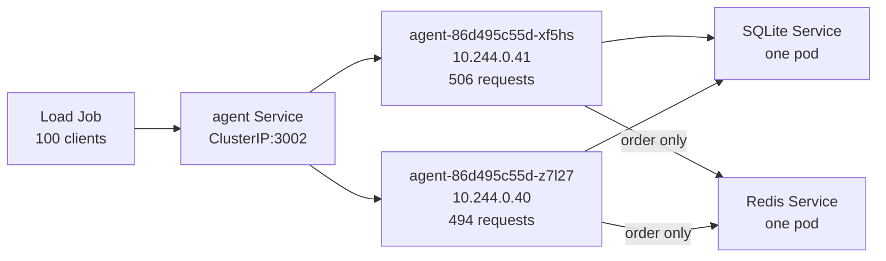

# Local Kubernetes mixed-intent load report — 2026-10-25

## Workload and result

One local `kind-rolling-lab` run sent 1,000 synthetic support turns through the `agent` Kubernetes Service at a limit of 100 concurrent clients. The load client interleaved four intent fixtures, giving exactly 250 requests per intent. The scenario-specific scripted model called the real `runSupportTurn` graph and one real support tool per request. It did not infer intent from the prompt or contact a model provider. The four prompts below each repeated 250 times; these were 1,000 unique request IDs and sessions, not 1,000 unique prompts.

| Intent | Fixed customer prompt | Tool | Successful / attempted | p50 / p95 client latency |
| --- | --- | --- | ---: | ---: |
| Order status | “Where is order W002?” | `lookup_order` | 250 / 250 | 742.9 / 1307.1 ms |
| Product search | “Do you have a camp mug?” | `search_products` | 250 / 250 | 323.7 / 780.0 ms |
| Promotion claim | “Please claim the Early Risers discount.” | `claim_early_risers` | 250 / 250 | 326.8 / 780.6 ms |
| Human handoff | “Please connect me to a person at ada@example.com.” | `capture_handoff` | 250 / 250 | 325.5 / 862.5 ms |

| Whole-run measure | Observed |
| --- | ---: |
| Correct responses / attempts | **1,000 / 1,000** |
| Client errors; wrong persisted pairs | **0; 0** |
| SQLite sessions / customer rows / assistant rows / checked pairs | 1,000 / 1,000 / 1,000 / 1,000 |
| Maximum observed in-flight clients | 100 |
| Client duration; mean completion rate | 4.979 s; 200.8 requests/s |
| **Peak completed QPS** | **282** in one sliding 1,000 ms window |
| Client latency p50 / p95 / max | 361.0 / 912.5 / 1526.3 ms |
| Redis order cache | 238 hits; 12 misses; 0 unavailable |

The cache was unused by the other 750 requests. The result is one instrumented local run. It is not a production capacity estimate or a speedup comparison with the earlier 64-client, order-only run: the workload, concurrency, and instrumentation differ.

## Routing through instances

| Intent | Pod `xf5hs` | Pod `z7l27` | Total |
| --- | ---: | ---: | ---: |
| Order status | 124 | 126 | 250 |
| Product search | 113 | 137 | 250 |
| Promotion claim | 127 | 123 | 250 |
| Human handoff | 142 | 108 | 250 |
| **All intents** | **506 (50.6%)** | **494 (49.4%)** | **1,000** |

Both pods had zero restarts. All pods in the snapshot ran on the same `rolling-lab-control-plane` kind node. These records demonstrate routing across two agent *instances*, not across Kubernetes nodes. The Service's endpoint choice was not directly traced; each agent emitted its own pod ID with the request trace ID. The equal 250-per-intent split is across the whole run, not a promise of equal live concurrency or pod allocation at each instant. The retained `request-routes.csv` gives the specific pod, IP, completion time, tool, result kind, HTTP status, latency, cache outcome, and estimated tokens for every request.

## Traffic, traces, and tokens

Peak completed QPS was the largest count of successful completion timestamps in any half-open sliding 1,000 ms interval. The peak window ran from `2026-10-25T02:51:39.524Z` through `02:51:40.515Z` and contained 83 order, 66 product, 66 promotion, and 67 handoff completions. This is a burst of completed turns, not a sustained rate.

The same window held **418,722 estimated tokens/s** across completed turns. Whole-run estimates were 1,434,250 input plus 50,750 output, for 1,485,000 total. Estimates use `cl100k_base` on scripted model input/output serializations. The scripted model made no provider calls, so provider usage, billing, generation rate, and provider latency are not applicable. The peak estimate attributes each turn's tokens to its completion time; it does not locate token generation in time.

Reconciliation matched **1,000 unique traffic IDs to 1,000 unique agent trace IDs**. There were no missing or duplicate records, unmatched pairs, scenario/tool/result mismatches, outcome mismatches, token mismatches, or span errors. The traces recorded 2,000 `model.complete` spans, 1,250 `sqlite.sessions`, 1,000 `sqlite.messages`, 250 `sqlite.streak`, 250 `redis.get`, and 12 `redis.set` spans. The SQLite readback then checked the exact customer and assistant content under each request ID outside the timed request interval. The promotion tool's payload was checked with the domain parser; product and handoff payloads were checked against their scenario contracts.

The run retained pod/resource and event snapshots, but the cluster had no Kubernetes Metrics API. CPU and memory peaks are therefore unmeasured. The promotion and handoff fixtures keep their intermediate state request-local. They verify graph/tool routing and immediate results, not cross-pod durability or retry behavior for those workflows.

## Evidence and reproduction

The tracked harness is in [`scripts/local-load`](../scripts/local-load/README.md), and the storage and routing boundaries are described in [the architecture](local-k8s-load-design.md). The run used `bash scripts/local-load/run-kind.sh` with the Job's `LOAD_TURNS=1000` and `LOAD_CONCURRENCY=100`. It rebuilt the local images, restarted disposable SQLite and Redis pods, waited for the Job to complete, and captured logs via the script's exit trap.

Raw artifacts are Git-ignored in `scripts/local-load/.data/runs/20261025T025031Z-97597/`. A retained copy is at `/Users/chuckl/.codex/visualizations/2026/10/23/01a169c9-dbf3-7d83-9529-44ff06a2607f/local-load-traffic/20261025-mixed-intents/`, including `load.jsonl`, `agent.jsonl`, `redis.log`, `sqlite.log`, `events.yaml`, `resources.yaml`, `reconciliation.json`, `independent-analysis.json`, `request-routes.csv`, and `mixed-intent-routing.png`. The traffic and trace JSONL plus the resource snapshot are the source of record for this report.

Before the run, repository verification passed: 213/213 Vitest tests across 51 files, TypeScript typecheck, focused ESLint, shell syntax, and diff whitespace checks. The run's trace reconciliation reported `valid: true` and balanced intents. All timing and throughput values include the local graph, scripted model, HTTP calls, SQLite, and trace work; SQLite readback occurs afterward.
