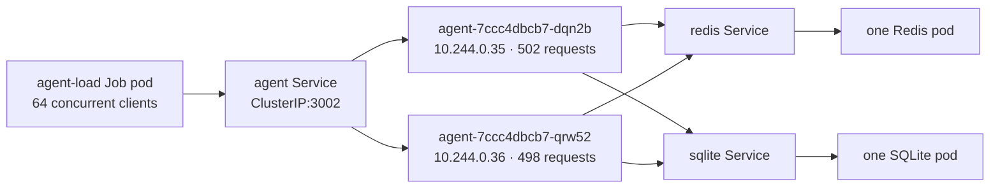

# Local Kubernetes traffic and trace report — 2026-10-24

## Scope and result

One monitored run sent 1,000 synthetic support turns from 64 concurrent clients to two agent pods in the local `kind-rolling-lab` cluster. The agent used the fixed order lookup fixture, a scripted model, Redis as a cache, and SQLite for session and message records. This measures the local simulation described in [the architecture](local-k8s-load-design.md), not production capacity or a real model provider.

| Measure | Observed result |
| --- | ---: |
| Correct responses / attempts | 1,000 / 1,000 |
| HTTP or reply validation errors | 0 |
| SQLite sessions / customer messages / assistant messages | 1,000 / 1,000 / 1,000 |
| Wrong SQLite replies | 0 |
| Client duration | 5.195 s |
| Average completed throughput | 192.5 requests/s |
| **Peak completed QPS** | **252** in a sliding 1,000 ms window |
| Client latency p50 / p95 / max | 300.6 / 648.3 / 895.8 ms |
| Redis cache outcomes | 991 hits, 9 misses, 0 unavailable |

The peak window contained 252 successful responses from `08:44:49.370` through `08:44:50.361` UTC. Its response latency p50/p95/max was 292.5/421.7/438.6 ms. Both agent pods contributed (132 and 120 responses). All 252 requests were cache hits. The client observed at most 64 requests in flight, matching its configured concurrency.

The fixed, nonoverlapping seconds from the client start had completion counts of 86, 183, 234, 218, 213, and 66. The peak of 252 uses a *sliding* one-second window, so it differs from the largest fixed-second bucket (234). It is a burst count, not a sustained throughput measurement.

## Route through Kubernetes instances

The load Job sent requests to `http://agent:3002/turn`, the agent Service selected one of two ready agent pod endpoints, and each agent used the Redis and SQLite Services. All five pods ran on the single `rolling-lab-control-plane` kind node, so this verifies routing across pod instances, not across Kubernetes nodes. The pod names and IPs above are from the captured Kubernetes resource snapshot; pod IPs are temporary. The traces prove which pod processed each request. They do not expose the Service's connection-selection decision or prove per-request round-robin routing. HTTP connection reuse can make multiple requests use the same selected endpoint.

| Client elapsed second | Pod `dqn2b` | Pod `qrw52` | Total |
| --- | ---: | ---: | ---: |
| 0–1 | 39 | 47 | 86 |
| 1–2 | 83 | 100 | 183 |
| 2–3 | 119 | 115 | 234 |
| 3–4 | 109 | 109 | 218 |
| 4–5 | 114 | 99 | 213 |
| 5–6 | 38 | 28 | 66 |
| **Entire run** | **502 (50.2%)** | **498 (49.8%)** | **1,000** |

The retained `request-routes.csv` joins every traffic record to its agent trace by request ID. It lists completion time, handling pod and IP, HTTP status, latency, cache outcome, estimated tokens, and model/Redis/SQLite call counts. For example, request `b31b6084-338a-4f16-9cd8-cc3281930e9d` completed on pod `qrw52` at `08:44:48.307` UTC. The CSV and `routing-timeline.png` are generated artifacts stored beside the raw logs, outside Git.

## Trace coverage and timings

The client wrote one `local_load.traffic` JSON record per attempt. Each agent wrote a `local_load.agent_trace` record with the same trace ID, pod ID, outcome, token estimate, and bounded named spans. Reconciliation found **1,000 unique traffic IDs and 1,000 unique agent trace IDs**, with no missing, duplicate, unpaired, token-mismatched, or outcome-mismatched records. Both agent pods had zero container restarts in the captured Kubernetes snapshot; the load Job succeeded.

| Span | Calls | p50 | p95 | Max | Errors |
| --- | ---: | ---: | ---: | ---: | ---: |
| Scripted `model.complete` | 2,000 | <0.01 ms | 0.01 ms | 2.09 ms | 0 |
| `redis.get` | 1,000 | 58.96 ms | 139.12 ms | 261.68 ms | 0 |
| `redis.set` | 9 | 91.72 ms | 105.24 ms | 133.09 ms | 0 |
| `sqlite.sessions` | 2,000 | 45.63 ms | 143.62 ms | 530.86 ms | 0 |
| `sqlite.streak` | 1,000 | 40.01 ms | 104.64 ms | 151.17 ms | 0 |
| `sqlite.messages` | 1,000 | 37.15 ms | 95.59 ms | 159.96 ms | 0 |

Every trace contained two scripted model calls, one Redis read, two SQLite session calls, one streak write, and one message write. The nine cache misses also contained a Redis write. Span durations are elapsed time at the agent call boundary and overlap with neither a separate CPU profile nor a distributed trace backend. The logged trace excludes prompt and customer text.

## Token estimate

| Measure | Estimated count |
| --- | ---: |
| Input tokens | 1,436,000 (1,436 per turn) |
| Output tokens | 49,000 (49 per turn) |
| Total | 1,485,000 |
| **Peak estimated token rate** | **374,220 tokens/s** in the same 252-response sliding window |
| Peak-window input / output | 361,872 / 12,348 |

These counts use `cl100k_base` on JSON serializations of each scripted model call's input and output. They are useful for comparing this fixed synthetic workload across runs. The scripted model makes no provider request, so provider token usage, billing, streaming rate, and provider latency are **not applicable**. The peak token rate sums estimates attached to completed requests in a one-second window; it does not measure when individual tokens were generated.

## Capture and calculation

The run was executed with `scripts/local-load/run-kind.sh` after rebuilding and loading the local images. The script retained the Job traffic log, agent trace log, SQLite and Redis logs, Kubernetes resources and events, and a reconciliation result under the Git-ignored `scripts/local-load/.data/runs/20261024T084351Z-91764/`. A copy was retained as a task artifact at `/Users/chuckl/.codex/visualizations/2026/10/23/01a169c9-dbf3-7d83-9529-44ff06a2607f/local-load-traffic/20261024T084351Z/`.

The request summary and peak values were independently recalculated from the retained JSONL traffic records. Peak QPS is the maximum number of successful completion timestamps within any half-open, sliding 1,000 ms interval. Peak estimated tokens/s uses those same completions. The raw logs, not this report, are the source of record. The cluster did not expose the Kubernetes Metrics API, so this run does not report pod CPU or memory peaks. This is one instrumented local run; the added trace and token counting work is included in its measured latency and throughput.
